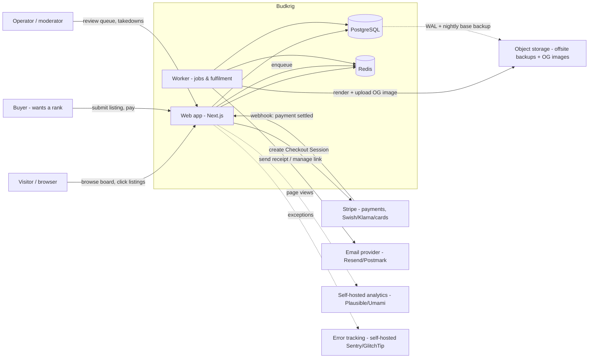
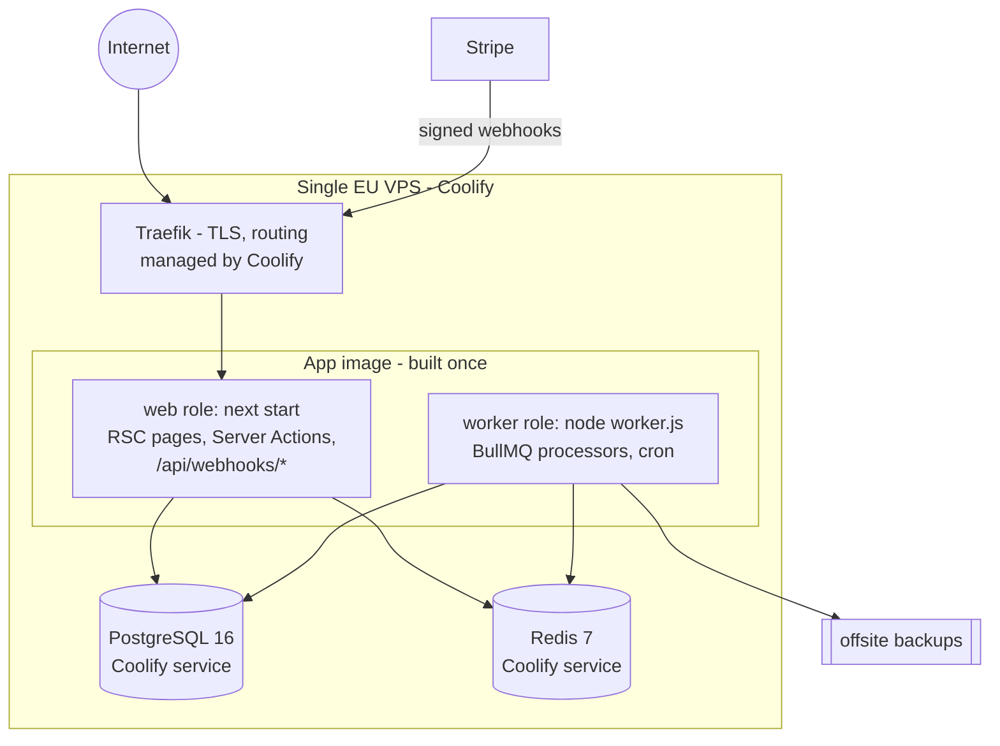

# Budkrig — Architecture Brief

Status: **Draft v0.1** · Owner: Viktor · Last updated: 2026-09-03

This is the one document to read first. It states what we are building, the
constraints we accept, the quality bar, and the shape of the system. Deep
decisions are delegated to the ADRs in [`../adr/`](../adr/); this brief only
summarises them and explains how they fit together.

---

## 1. Context and problem

`outbid.lol` launched in August 2026 and did ~$120k in non‑refundable payments
and ~1M visitors in 48 hours with a single developer. The mechanic is a
**dollar auction dressed as an ad placement**: you pay to occupy a rank on a
public leaderboard, the amount you paid *is* your rank, prior payments are never
returned, and every raise lifts the floor for the next person.

We want the same product localised for **Sweden**: Swedish language, Swedish
payment methods (Swish first), SEK, Swedish invoicing/VAT, EU consumer‑law
compliant checkout, EU data residency. Same viral loop, same SEO surface (every
listing is an indexable page that links out to the buyer's site).

### Why this is interesting architecturally

It looks trivial ("a sorted list") but three things make it not:

1. **It is a payments product with a money ledger.** Every rank is backed by
   real, non‑refundable money. Correctness under concurrency and partial
   failure is the whole game. A double‑charge, a lost payment, or a wrong rank
   is a support/chargeback/reputation incident, not a cosmetic bug.
2. **Traffic is extremely spiky.** A single tweet can take it from 5 to 5,000
   concurrent users in a minute. The read path (the board) must survive that
   on one small server; the write path (claim a rank) must stay correct while
   it does.
3. **It is adversarial from day one.** Competitors listing each other,
   offensive content, malware URLs, chargebacks, and payment fraud all show up
   in week one because money and public visibility are involved.

---

## 2. Goals

- **G1 — Ship the core loop fast.** Browse board → pick a spot → pay → listing
  is live and ranked. This is the entire product; everything else is optional.
- **G2 — Never get the money wrong.** No double charges, no paid‑but‑not‑live
  listings, no listing live without a settled payment, an auditable trail for
  every öre.
- **G3 — Survive a viral spike on one modest VPS.** The board stays fast and
  correct at 100× baseline read traffic without manual intervention.
- **G4 — Be legally launchable in Sweden.** Correct VAT + invoices, a checkout
  that satisfies EU distance‑selling rules, GDPR‑clean data handling, EU
  hosting, and a documented answer to "is this gambling?".
- **G5 — Maximise the SEO surface.** Every listing is a fast, server‑rendered,
  crawlable page with structured data and a good OG image.
- **G6 — Stay operable by one person.** Self‑hosted, reproducible, one‑command
  deploy, backups that are actually restorable, alerting that reaches a phone.

## 3. Non‑goals (for v1)

- No mandatory user accounts, profiles, or social graph. Ownership of a listing
  is proven by email (ADR‑0008).
- No real‑time websocket firehose. Near‑real‑time via revalidation + polling +
  SSE is enough (ADR‑0009).
- No native mobile apps. Responsive web only.
- No multi‑currency. SEK only (ADR‑0004).
- No auction *end* / winner payout / escrow. Listings are perpetual.
- No microservices. One deployable web app + one worker (ADR‑0002, ADR‑0010).
- No Kubernetes, no multi‑region, no read replicas until data says otherwise.
- No ad-network style targeting/tracking of outbound clicks beyond an
  aggregate counter.

## 4. Quality attributes (non‑functional requirements)

| # | Attribute | Target for v1 | How we get there |
| --- | --- | --- | --- |
| N1 | **Correctness of money** | 0 tolerated discrepancies; every listing state change traceable to a settled payment event | Append‑only bid + payment ledger, integer öre, idempotent webhook fulfilment, DB transactions with row locks (ADR‑0004, 0005) |
| N2 | **Read availability** | Board + listing pages 99.9% monthly, p95 < 300 ms at 2k rps from cache | Server components + HTTP caching + `stale-while-revalidate`, Redis read cache, CDN‑friendly headers; board is fully renderable from cache (ADR‑0009) |
| N3 | **Write integrity under load** | Concurrent claims never corrupt rank or double‑spend; a claim either fully completes or is fully refunded | Fulfilment is webhook‑driven and idempotent; per‑listing row lock; amounts are absolute so concurrent claims can't deadlock (ADR‑0005) |
| N4 | **Spike elasticity** | Absorb 100× baseline reads for 1h with no ops action | Cache-first read path, no per-request DB fan-out, connection‑pool ceiling, graceful degradation (serve slightly stale board) |
| N5 | **Time‑to‑live for a paid listing** | < 10 s from payment settled to listing visible (p95); Swish is async so measured from webhook receipt | Worker processes fulfilment immediately on webhook; targeted cache invalidation |
| N6 | **Recovery** | RPO ≤ 15 min, RTO ≤ 1 h | WAL‑archived Postgres + nightly base backup to offsite object storage, documented + rehearsed restore (ADR‑0011) |
| N7 | **Security** | No secrets in the client bundle; PCI scope = SAQ‑A; all mutations authenticated/authorised + rate‑limited | Hosted Stripe Checkout (card data never touches us), signed webhooks, signed listing‑management links, per‑IP + per‑listing rate limits (ADR‑0006, 0007, 0008) |
| N8 | **Privacy / compliance** | GDPR‑defensible; EU‑only data; DPA with every subprocessor | EU VPS, EU Stripe account, self‑hosted privacy‑friendly analytics, minimal PII (email + payment metadata), documented retention (ADR‑0013, 0015) |
| N9 | **Operability** | One‑command deploy; mean time to detect incident < 5 min | Coolify + Dockerfile, health checks, uptime + error + log alerting to phone (ADR‑0011, 0013) |
| N10 | **Change safety** | Main is always deployable; every merge passes typecheck + lint + unit + e2e | Trunk‑based dev, CI gates, migrations forward‑only and backward‑compatible (conventions) |

If a future decision trades one of these away, that trade goes in an ADR.

---

## 5. System context (C4 level 1)

## 6. Container view (C4 level 2)

One Docker image, two runtime roles, two stateful services. All of it lives on
one Coolify project on one VPS for v1.

Why this shape: ADR‑0002 (one Next.js app, no API split), ADR‑0010 (worker is
the same image with a different command), ADR‑0011 (Coolify, Postgres + Redis
as managed services on the same host).

---

## 7. Domain model (summary)

Full version with invariants: [`domain-model.md`](domain-model.md).

- **Listing** — a URL or `@handle` on the board. Has a `current_amount_ore`
  (its rank key), a `category`, a `status`, and an `owner_email`.
- **Bid** — an append‑only row: "on this date, this listing paid `delta_ore`,
  taking it from `previous_amount_ore` to `resulting_amount_ore`". The bid
  ledger is the source of truth; `listing.current_amount_ore` is a derived
  cache maintained in the same transaction.
- **Payment** — a settled charge from Stripe tied to exactly one bid. Carries
  the provider reference, method, VAT breakdown, and the raw event for audit.
- **Category** — a fixed, seeded list (SEO landing pages), each with its own
  sub‑leaderboard.
- **WebhookEvent** — every inbound Stripe event, stored by provider event id
  for idempotency and replay.
- **ModerationAction** — audit trail for hides, takedowns, category
  re‑assignments.
- **ClickEvent** → aggregated into `listing.click_count`.

**Rank** is not stored. It is computed: order active listings by
`(current_amount_ore DESC, first_active_at ASC)`. A single listing's position
is one indexed `COUNT(*)` query. See ADR‑0005 for why amounts are absolute and
non‑unique, and why that removes most concurrency hazards.

---

## 8. Critical flows (summary)

Full sequence diagrams: [`core-flows.md`](core-flows.md).

1. **Claim a rank.** Validate input → create a `pending` bid + `pending`
   payment → create a Stripe Checkout Session → redirect. Stripe collects the
   money (card = instant, Swish/Klarna = async). On `checkout.session.completed`
   (and `payment_intent.succeeded`) the webhook enqueues a fulfilment job. The
   worker, in one DB transaction: locks the listing row, appends the bid,
   updates `current_amount_ore`, flips the listing to `active`, records the
   payment, invalidates caches, sends the receipt + management link. Idempotent
   on the provider event id.
2. **Payment fails / is abandoned.** The `pending` bid + payment expire via a
   cron sweep; nothing becomes visible; no state change to the listing.
3. **Raise an existing listing.** Same as claim, but keyed by the existing
   listing; the buyer pays `new_target − current` and must clear
   `current + MIN_INCREMENT`.
4. **Chargeback / dispute.** `charge.dispute.created` → flag listing, notify
   operator, do **not** auto‑hide; decision is manual (ADR‑0012).
5. **Moderation.** New listings enter a review queue if they trip an
   auto‑check (denylist, new domain, risky TLD); operator can hide/restore;
   every action audited.

---

## 9. Environments

| Env | Purpose | Data | Hosting |
| --- | --- | --- | --- |
| `local` | Development | Disposable, seeded | Docker Compose (`docker/compose.yaml`) |
| `preview` | Per‑PR / manual QA | Disposable, seeded | Coolify, Stripe test mode |
| `production` | Live | Real, backed up | Coolify, Stripe live mode |

No shared "staging" database. Preview is production‑like but disposable.
Details + the deploy pipeline: [`infrastructure.md`](infrastructure.md).

---

## 10. Roadmap

**Milestone 0 — Prep (this repo, done when merged)**
Architecture brief, ADRs, conventions, scaffold, `BOOTSTRAP.md`, risk register.

**Milestone 1 — Walking skeleton (1 week)**
Empty Next.js app deployed to Coolify through CI. Postgres + Redis wired.
`GET /healthz`, one seeded listing rendered from the DB, structured logging,
error tracking, uptime alert. Proves the pipeline end to end.

**Milestone 2 — The core loop (2–3 weeks)**
Board (all‑time + today), listing detail pages, categories. Claim/raise flow
with Stripe **test mode**: Checkout Session, webhook, worker fulfilment, bid
ledger, idempotency, cache invalidation, receipt email, signed management
link. Load test the claim flow and the board.

**Milestone 3 — Sweden‑ready (1–2 weeks)**
Swish + Klarna + cards live, Swish‑before‑credit ordering, Stripe Tax + VAT
invoices, EU withdrawal‑right consent step, Swedish copy (`sv` default),
imprint/`företagsinformation`, privacy policy, cookie‑free analytics.

**Milestone 4 — Adversarial hardening (1 week)**
Moderation queue, denylist, domain/TLD heuristics, rate limits, dispute
handling, abuse runbook. Backup **restore rehearsal**.

**Milestone 5 — Launch gate**
Every box in ADR‑0015 (legal & compliance gate) checked. Then launch.

Post‑launch backlog (not scheduled): SSE activity feed, "online now" presence,
daily digest, referral attribution, admin analytics, second currency.

---

## 11. Open questions

| # | Question | Needs input from | Blocks |
| --- | --- | --- | --- |
| Q1 | Company vehicle for invoicing/VAT — existing AB, new AB, or enskild firma with F‑skatt? | Founder / accountant | M3, M5 |
| Q2 | Is the mechanic a lottery/"combination gambling" under Spellagen (2018:1138)? Need a written opinion. | Swedish lawyer | M5 (launch gate) |
| Q3 | Min increment rule — flat +1 kr everywhere, or higher for the top spots (outbid.lol appears to use +5 for #1)? | Founder (product) | M2 |
| Q4 | Do we verify domain ownership before letting someone list a domain, or allow anyone to list anything (outbid.lol does the latter)? | Founder + legal | M2, M4 |
| Q5 | Refund policy for genuinely fraudulent/mistaken payments — hard "never" or discretionary within 24h before listing goes live? | Founder + legal | M2 |
| Q6 | VPS provider and region — Hetzner (DE/FI), Glesys/Bahnhof (SE) for a stronger data‑residency story? | Founder | M1 |
| Q7 | Starting amount and currency granularity — 5 kr? 49 kr? Does the "cheap to start" hook matter for SEK? | Founder (product) | M2 |

Answers get folded back into the relevant ADR or this brief.
