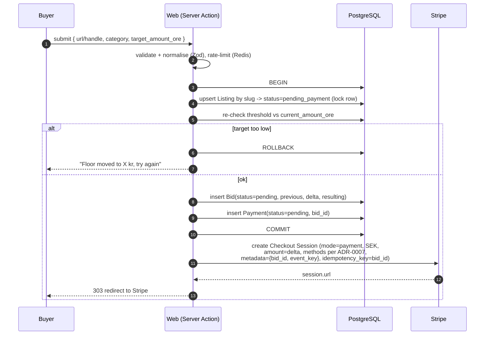
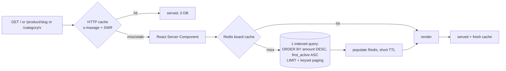

# Core Flows

Companion to [`00-overview.md`](00-overview.md) and
[`domain-model.md`](domain-model.md). Decisions referenced here are in
[`../adr/`](../adr/).

---

## Flow 1 — Claim or raise a rank

The single most important flow. It must be **correct under concurrency** and
**atomic under partial failure**: the buyer either ends up with a live listing
*and* a charge, or with neither.

### 1a. Request (synchronous, in the web app)



Notes:
- The listing goes to `pending_payment` but is **not** shown on the board
  (`status != active`). If it already existed and was `active`, it stays
  `active` at its old amount; the pending bid does not change
  `current_amount_ore`.
- `event_key` is a random idempotency token we generate and also store on the
  bid, so we can correlate even if Stripe metadata is truncated.
- We do **not** hold a DB transaction open across the Stripe call.

### 1b. Fulfilment (asynchronous, webhook + worker)

Card payments settle in seconds; **Swish and Klarna are asynchronous** (the
buyer confirms in the bank/BNPL app), so fulfilment is *always* webhook‑driven —
there is no "success" code path in the redirect handler that touches money.

```mermaid
sequenceDiagram
    autonumber
    participant S as Stripe
    participant WH as Web /api/webhooks/stripe
    participant Q as Redis (BullMQ)
    participant WK as Worker
    participant DB as PostgreSQL
    participant C as Cache (Redis)
    participant E as Email

    S->>WH: POST event (signed)
    WH->>WH: verify signature (raw body)
    WH->>DB: insert WebhookEvent (unique provider_event_id)
    alt duplicate event id
        WH-->>S: 200 (already have it)
    else new
        WH->>Q: enqueue fulfil-payment { event_id }
        WH-->>S: 200
    end

    WK->>Q: pick up job
    WK->>DB: BEGIN
    WK->>DB: SELECT WebhookEvent FOR UPDATE; if processed_at set -> COMMIT, done
    WK->>DB: load Bid + Payment by metadata; SELECT listing FOR UPDATE
    WK->>WK: re-validate threshold (authority check)
    alt still valid
        WK->>DB: Bid.status=settled, settled_at=now
        WK->>DB: Payment: status=settled, method, VAT, invoice_number, raw_event
        WK->>DB: Listing.current_amount_ore = resulting; status=active;<br/>first_active_at ??= now; last_bid_at=now
        WK->>DB: WebhookEvent.processed_at = now
        WK->>DB: COMMIT
        WK->>C: invalidate board + category + listing keys
        WK->>E: enqueue receipt + signed management link
    else threshold no longer clearable (rare: only if MIN rules changed)
        WK->>DB: Bid.status=settled, Payment.status=settled  (money is real)
        WK->>DB: Listing gets the amount anyway (amounts are absolute; it just ranks where it ranks)
        WK->>DB: COMMIT
        note over WK: We never take money without giving the rank.<br/>See ADR-0005: absolute amounts make this safe.
    end
```

### Concurrency: two buyers claim "#1" at the same time

Because **amounts are absolute and need not be unique** (ADR‑0005), there is no
contended resource to serialise on beyond each listing's own row:

- Buyer A pays to reach 17 005 öre‑kr, Buyer B pays to reach 17 005 too.
- Both settle. Both listings get `current_amount_ore = 1700500`.
- The board orders them by `first_active_at ASC` — whoever's fulfilment
  committed first is #1. The other is #2 and sees "you're one behind, raise
  again".
- Nobody is charged without receiving a rank. No rollback, no refund, no
  deadlock.

The only row lock is `SELECT ... FOR UPDATE` on the **single listing** being
fulfilled, which serialises multiple payments *for the same listing* (rare, but
possible if an owner double‑submits). That is a short, uncontended lock.

### Partial‑failure matrix

| Failure point | Outcome | Recovery |
| --- | --- | --- |
| Crash after 1a COMMIT, before Stripe session | `pending` bid+payment, no session | Cron sweep expires them after 30 min. Buyer saw an error, retries. |
| Buyer abandons Stripe page | Same as above | Same. |
| Crash after `200` webhook, before worker runs | Job is in Redis (persisted) | Worker picks it up on restart. |
| Worker crashes mid‑transaction | DB rolls back; `WebhookEvent.processed_at` still null | BullMQ retries the job (idempotent). |
| Stripe sends event twice | Second insert hits unique constraint | Webhook returns 200, no job enqueued. |
| We miss a webhook entirely (downtime) | `pending` bid, money taken at Stripe | Nightly reconciliation lists Stripe `payment_intent`s with no settled bid → operator/worker replays. |
| Redis down | Webhook can't enqueue | Webhook returns 500, **Stripe retries for up to 3 days**. Also: reconciliation catches it. |

---

## Flow 2 — Browsing the board (the read path)

This is 99%+ of traffic and must be cache‑served.



Rules:
- The board is rendered from **one** query. No N+1, no per‑card lookups.
- Cache key includes board type (`all` / `today`), category, and page cursor.
- `today` board = listings that have a bid with `created_at::date = today`
  (Europe/Stockholm), ordered by sum of today's deltas, or by current amount —
  pick one and document it (Open question Q3‑adjacent).
- Fulfilment (Flow 1b) does **targeted** invalidation, not a global flush.
- Degradation: if Postgres is slow/unavailable, serve the last good cached
  board with a stale banner rather than erroring.
- Outbound click: `GET /go/{slug}` → record ClickEvent (fire‑and‑forget to
  Redis) → 302 to `target_url` with `utm_source=budkrig`. Never a redirect
  based on user input; `slug` is looked up, not reflected.

---

## Flow 3 — Listing management (no accounts)

```mermaid
sequenceDiagram
    participant O as Owner
    participant W as Web
    participant E as Email
    O->>W: "manage my listing" + email
    W->>W: rate-limit; always respond "check your inbox" (no enumeration)
    W->>E: if email owns a listing -> signed link /manage?token=... (JWT, 24h, single-listing scope)
    O->>W: opens link
    W->>W: verify token signature + expiry + scope
    O->>W: edit title/description/target_url (NOT amount, NOT category once ranked)
    W->>W: changes go through the same moderation checks as a new listing
```

Signing key is server‑only. Tokens are single‑listing, short‑lived, and
re‑issued on each request. See ADR‑0008.

---

## Flow 4 — Moderation

- **Pre‑publish auto‑checks** run in Flow 1b before `status=active`: domain/@handle
  against a denylist, brand‑new domain age, risky TLD, profanity/scam keyword
  scan on title+description, URL reachability + malware list. Trip any → listing
  becomes `active` but `flagged`, surfaced in the operator queue. (We do not
  block the buyer — money is taken, rank is given, review is after.)
- **Operator queue**: hide / restore / recategorise / edit copy. Every action
  writes a `ModerationAction` with before/after.
- **Hidden** listings keep their amount and `first_active_at`; they just don't
  render. Restoring is lossless.
- **Dispute** (`charge.dispute.created`): flag + alert, no auto‑action.

---

## Flow 5 — Scheduled jobs (worker cron)

| Job | Cadence | Does |
| --- | --- | --- |
| `expire-pending` | every 5 min | `pending` bids/payments older than 30 min → `expired` |
| `reconcile-stripe` | hourly | Stripe payment_intents (last 72h) with no settled bid → alert + attempt replay |
| `assert-ledger` | hourly | For each active listing, assert `current_amount_ore` == replayed ledger; alert on mismatch |
| `aggregate-clicks` | every 5 min | Fold ClickEvent → `listing.click_count`; delete rows > 30 days |
| `refresh-og-images` | on demand + daily | Render + upload OG images for new/changed listings |
| `db-backup-verify` | daily | Assert last night's backup exists and restores into a scratch DB |
