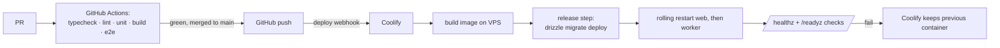

# Infrastructure & Delivery

Companion to [`00-overview.md`](00-overview.md). Decision detail in
[ADR‑0011](../adr/0011-self-hosted-deployment-on-coolify.md).

## Topology (v1)

One VPS, one Coolify project, one Docker image used for two roles.

```
EU VPS (Ubuntu LTS)  ── Coolify ──┬── traefik (TLS via Let's Encrypt)
                                  │
                                  ├── budkrig-web      (app image, cmd: node server.js)
                                  ├── budkrig-worker   (app image, cmd: node dist/worker.js)
                                  ├── postgres:16      (Coolify managed service)
                                  └── redis:7          (Coolify managed service, AOF on)
```

Services talk over Coolify's private network. Only `traefik` is exposed
(80/443). Postgres and Redis are **not** published to the internet.

### Sizing

Start: 4 vCPU / 8 GB / 80 GB NVMe (e.g. Hetzner CPX31 or CCX). The read path is
cache‑served so CPU headroom is mostly for spike rendering and the worker.
Vertical scaling is the plan up to a large single box; ADR‑0011 covers when to
revisit.

## The image

Multi‑stage `Dockerfile` (repo root, so Coolify's default detection works;
`docker/` keeps compose + db init):

1. `deps` — install with a locked lockfile.
2. `build` — `next build` with `output: "standalone"`, plus `tsc` for the
   worker bundle.
3. `runner` — distroless/slim node, non‑root user, copies
   `.next/standalone`, `.next/static`, `public`, and the worker bundle.
   `HOSTNAME=0.0.0.0`, `PORT=3000`.

The same image runs the web (`node server.js`) and the worker
(`node dist/worker.js`). Role is chosen by the container's start command, set
per‑service in Coolify.

## Deploy pipeline



- **Migrations run as a pre‑deploy / release step**, not in the app entrypoint,
  so a bad migration fails the deploy instead of crash‑looping every replica.
  Migrations are **forward‑only and backward‑compatible** (expand/contract) so
  the old container keeps working during the swap — see conventions.
- **Secrets** live in Coolify's per‑service env config (encrypted at rest),
  never in the repo. `.env.example` documents every key.
- **Rollback**: Coolify retains the previous image; redeploy it. DB rollback is
  a *new* forward migration, never a down‑migration in production.

## Environments

| | `local` | `preview` | `production` |
| --- | --- | --- | --- |
| Runs on | Docker Compose | Coolify (separate project) | Coolify |
| Postgres/Redis | Compose services | Coolify services (small) | Coolify services |
| Stripe | test keys | test keys | live keys |
| Data | seeded, disposable | seeded, disposable | real, backed up |
| Emails | Mailpit (caught locally) | test provider / caught | live provider |
| Analytics | off | off | on |

`docker/compose.yaml` brings up the whole local stack: web, worker, postgres,
redis, mailpit.

## Backups & recovery  (targets: RPO ≤ 15 min, RTO ≤ 1 h)

- **Continuous**: Postgres WAL archiving to offsite object storage (different
  provider/region than the VPS).
- **Nightly**: `pg_basebackup` / logical dump, encrypted (age/gpg) before it
  leaves the host, uploaded offsite, 30‑day retention + 6 monthly.
- **Redis**: AOF enabled. Redis holds only cache + queue; a loss costs
  in‑flight jobs (Stripe re‑sends webhooks for 72h and reconciliation catches
  the rest) and a cold cache. Not part of RPO.
- **Rehearsed**: `db-backup-verify` cron restores last night's backup into a
  scratch database daily and asserts row counts + ledger invariants. A restore
  that isn't tested is not a backup.
- **Runbook**: `docs/runbooks/restore.md` (write during Milestone 1).

## Observability

| Concern | Tool (self‑hosted, EU) | Alert path |
| --- | --- | --- |
| Uptime / synthetic | Uptime Kuma hitting `/healthz`, the board, and a canary claim | Push → phone |
| Errors | Sentry (self‑hosted) or GlitchTip | Push → phone on new issue / spike |
| Logs | `pino` JSON → Coolify log drain / Loki | Query on demand |
| Metrics | OpenTelemetry → Prometheus + Grafana (or Coolify's built‑ins to start) | Grafana alerts: DB connections, queue depth, webhook lag, 5xx rate |
| Product analytics | Plausible or Umami (self‑hosted, cookie‑free) | — |
| Payments | Stripe dashboard + a daily "revenue & disputes" digest email from the worker | — |

Key custom signals: **webhook‑to‑fulfilment lag**, **BullMQ queue depth**,
**pending‑bid age**, **ledger‑assertion failures**, **board cache hit rate**.

## What we are NOT doing in v1 (and the trigger to reconsider)

| Not doing | Reconsider when |
| --- | --- |
| Managed DB (RDS etc.) | Backup rehearsals fail repeatedly, or on‑call fatigue |
| Read replicas | Board p95 > 300 ms *after* cache tuning |
| Multi‑node / autoscaling | One big VPS can't hold a spike, proven by load tests |
| CDN in front | Origin egress or latency to non‑SE users becomes a real number |
| Kubernetes | Never, for this product, unless the team grows a lot |
| Blue/green | Rolling + health checks cause a user‑visible blip |
